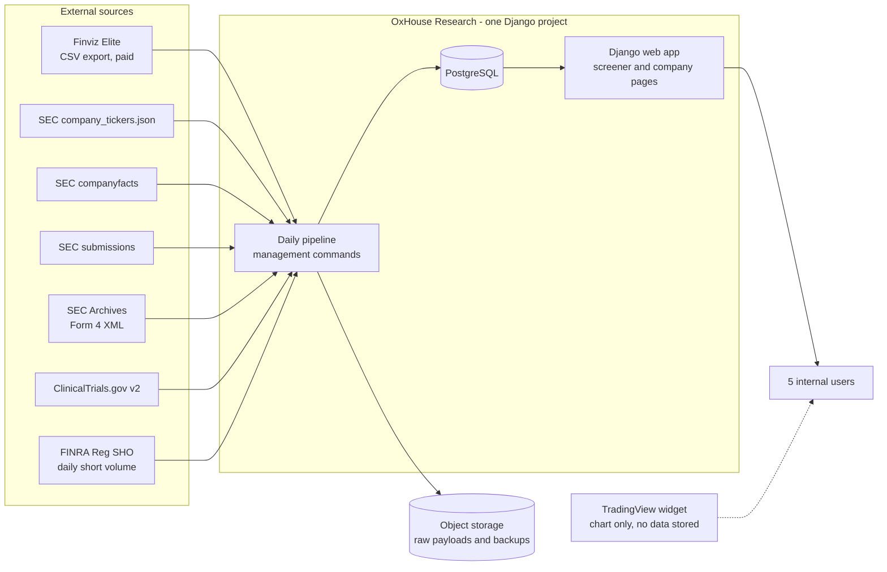
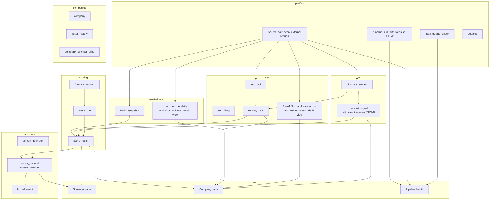
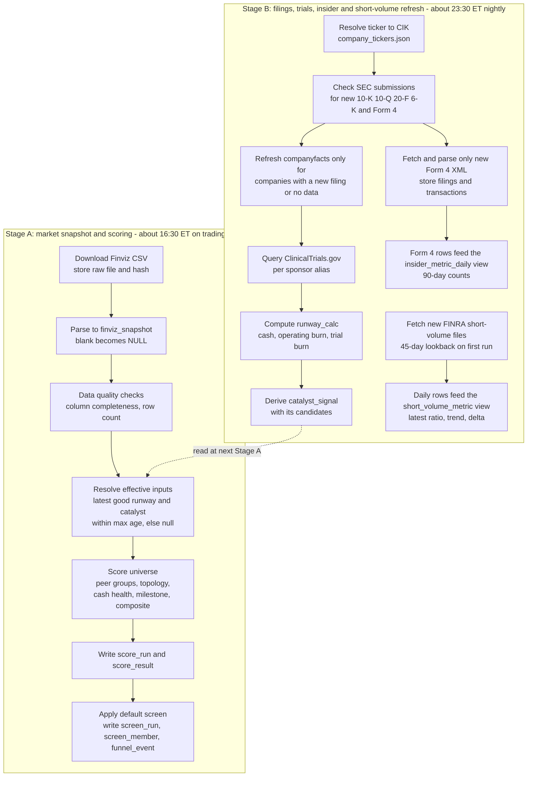
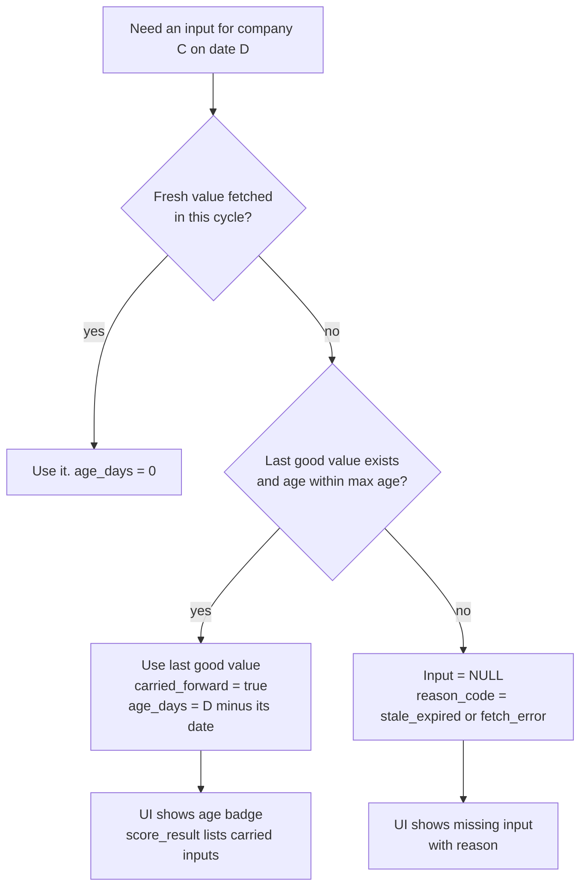
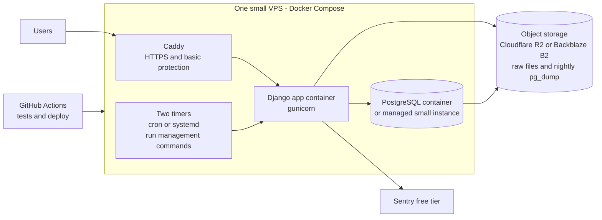
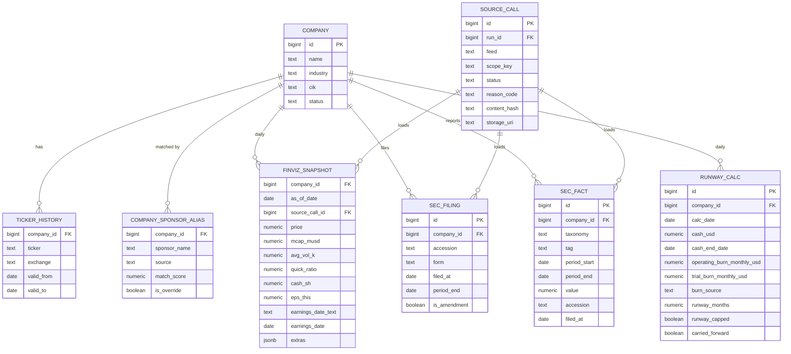
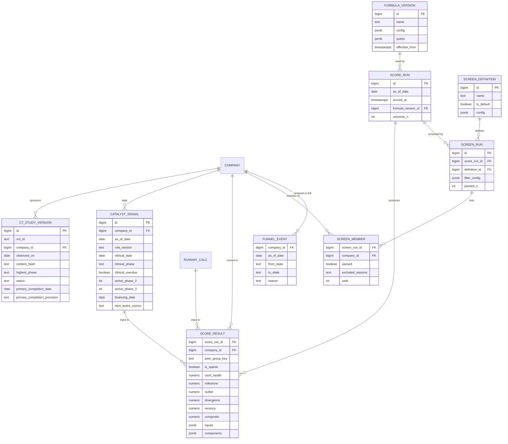
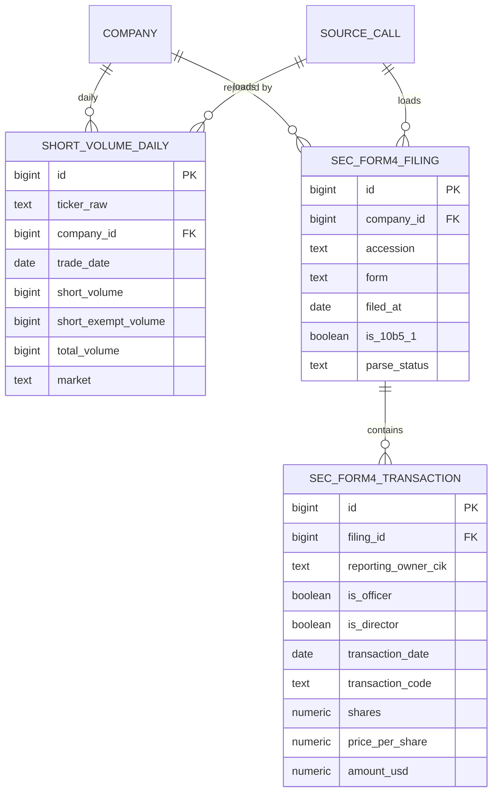
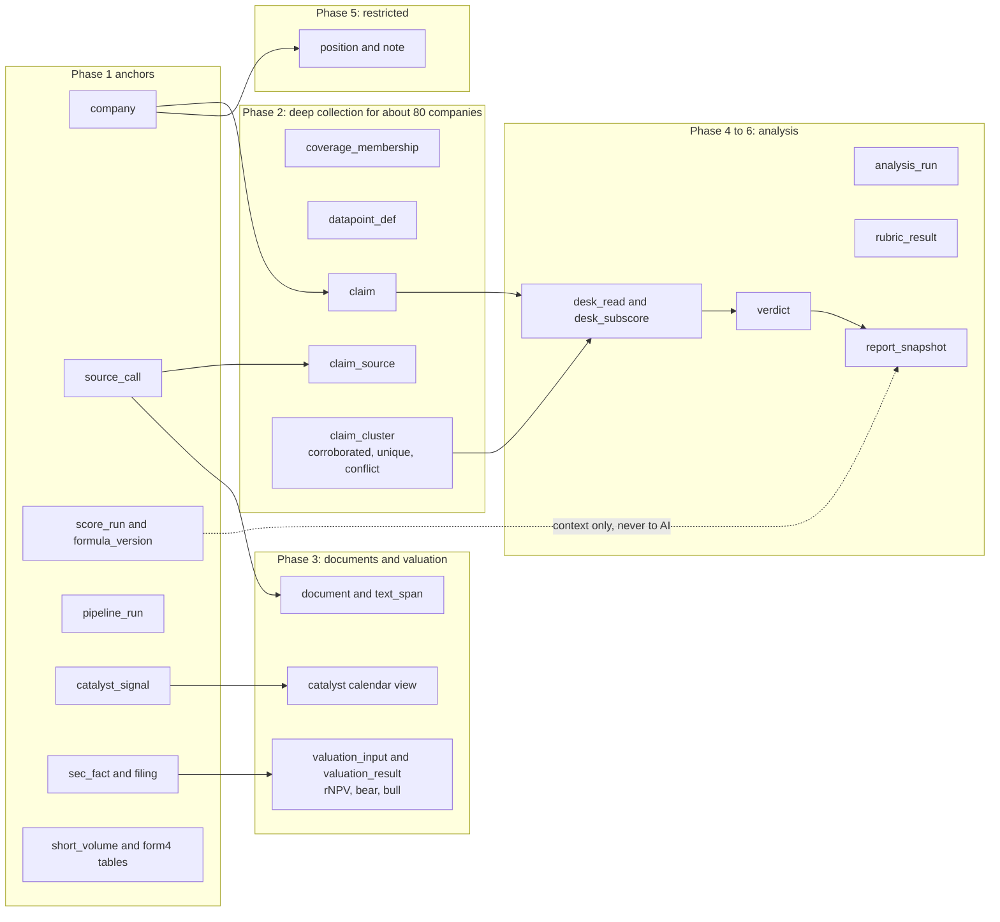

# OxHouse Research: Architecture and Data Model (v5, Phase 1 focus)

Status: proposal, subject to change in later phases. Nothing here has been implemented, and nothing has been written to the repository.

Goal of this document: give a senior Django engineer enough structure to build **Phase 1 (the screener)** now, while keeping the model flexible enough that the later phases (evidence and claims, AI desk reads, verdict, valuation, positions) attach to it without reworking what Phase 1 builds.

---

## What changed in v5

v5 consolidates storage and adds one rule for how the UI reads the data. No field, source or
pipeline behaviour changes; the same 55 page fields are collected for every company each day.

| Change | Effect |
|---|---|
| 7 tables removed | Phase 1 goes from 30 tables to 23 (the screening phase only) |
| Explanatory detail moves into JSONB on its parent row | `pipeline_step` (as `pipeline_run.steps`), `runway_trial_burn_line` (as `runway_calc.trial_burn_lines`), `catalyst_candidate` (as `catalyst_signal.candidates`), `peer_group_stat` (as `score_run.peer_group_stats`) |
| Reason codes become code, not a table | A fixed list in the code base (Django choices) and the section 4.9 list; the database stores the code text |
| Two metric tables become database views | `short_volume_metric` and `insider_metric_daily` are computed from `short_volume_daily` and `sec_form4_transaction`; carry-forward becomes automatic because the view always uses the latest source rows and reports their age |
| Read-model rule | The API reads only from one read model, the `company_page` view (section 4.11); it never joins base tables per request |

The Phase 1 list in section 4 is the v5 list. Everything below the table list that still says v4 describes unchanged behaviour.

---

## What changed in v4

Decision: **every field on the company page is collected for every company in the pre-screen
universe (about 1,053) in the daily batch.** The field list (55 rows, five sources) is unchanged
from the previous version of the spreadsheet; what changed is where the work happens.

| Change | Effect |
|---|---|
| FINRA short volume and SEC Form 4 insider activity move from Phase 2 into the universe-wide daily batch | 9 of the 55 fields (3 short-volume, 6 insider) are now Phase 1, for all companies |
| Two collection tiers are defined | **Tier 1:** the universe-wide daily batch (this document). **Tier 2:** deep collection for about 80 companies, from different sources, in later phases |
| New tables and views | Tables `short_volume_daily`, `sec_form4_filing`, `sec_form4_transaction`; views `short_volume_metric` and `insider_metric_daily` (v5) |
| New pipeline steps in Stage B | Fetch FINRA files, discover and parse new Form 4 filings, compute the two metric tables |
| One shared SEC rate limiter | Submissions, company facts and Form 4 XML all draw on the same 10-requests-per-second allowance |
| Field lineage appendix | Appendix A maps all 55 page fields to their source, collector, table and stage |
| Phase 2 redefined | Deep collection for about 80 companies using other sources; no longer includes FINRA or Form 4 |

No existing table changes. No new Django app is needed: short volume lives in `marketdata` and
Form 4 in `sec`.

---

## 1. Scope

### 1.1 What Phase 1 delivers

1. A **daily universe** of healthcare companies from the Finviz Elite export, stored as dated snapshots.
2. **Universe-wide daily collection.** Every company-page field is collected for every company
   in the universe in the daily batch, from five sources:
   - Finviz: all 50 export columns.
   - SEC: runway (computed from XBRL facts, plus trial burn from ClinicalTrials.gov counts) and
     **Form 4 insider activity**.
   - ClinicalTrials.gov: all studies, and the **clinical catalyst** derivation.
   - FINRA Reg SHO: **daily short volume**.
3. **Scoring**, all deterministic and reproducible: Cash Health, Milestone, Outlier, Divergence, Recency, Composite.
4. A **screener UI**: adjustable filters with live counts, ranked table, "why was X excluded", funnel log, near-the-line list.
5. A **company page** showing all 55 fields: chart, metric tiles, score panels with their components, runway, catalyst, trial, short-selling and insider panels, and a data-vintage footer.
6. A **pipeline health page**: what ran, what failed, how stale each input is.

### 1.2 What is deliberately left for later

| Later phase | What it adds | How Phase 1 prepares for it |
|---|---|---|
| 2: Deep collection (about 80 companies) | Sources beyond the daily batch: filing text, press releases, advisory and KOL data, claims with sources | Raw-call log with hashes, company identity tables, vintage on every row |
| 3: Documents and risk | Filing text extraction, dilution, valuation (rNPV), catalyst calendar | `catalyst_signal.candidates`, `sec_fact`, `source_call` already store provenance |
| 4: Desk reads | Three pillar reads with direction, confidence, narrative | `as_of_date` plus `produced_at` pattern; score tables are readable context |
| 5: Judgment | Comparison, positions, scenarios | Restricted schema and database roles reserved |
| 6: Verdict | Rating, conviction, catalysts, risks | Versioned formula and run tables reused |

### 1.3 Source-of-truth decisions already made

| Decision | Value |
|---|---|
| Framework | Python and Django, built by a senior Django engineer |
| Cost target | As cheap as possible |
| Scoring owner | This tool computes every score itself |
| Composite | Five-part: Cash 30%, Milestone 35%, Outlier 15%, Recency 10%, Divergence 10% |
| Composite floor | 5, adjustable in the UI |
| Failed source call | Carry forward the last good value with an age flag |
| Data sources | Finviz Elite (paid, owned), SEC EDGAR (facts, submissions, Form 4), ClinicalTrials.gov v2, FINRA Reg SHO |
| Daily batch scope | All 55 company-page fields for every company in the pre-screen universe. Deep collection (about 80 companies) uses different sources in later phases |
| Screening scores | Never shown to AI layers (applies from Phase 4) |
| Rubric | Blue Ox v2.1, final stage, out of scope for Phase 1 |

---

## 2. Architecture

### 2.1 System context

### 2.2 Component view (Django apps)

Notes:
- **One Django project, several apps.** Module boundaries are enforced by convention and code review. In Phase 1 all tables live in the default schema with app-prefixed names. Only the future `restricted` schema (positions, notes) needs real schema and role separation, and it is created when it is first needed.
- **Scoring is a pure-Python package** with no database access. The pipeline hands it a plain dictionary of inputs per company and gets scores back, so the golden regression tests run without a database.
- Later-phase apps (`evidence`, `analysis`, `valuation`, `rubric`, `positions`) are added beside these and read the same `company` and run tables.
- FINRA short volume lives in `marketdata` and Form 4 insider data in `sec`, so v4 adds tables but no new app.

### 2.3 Daily pipeline

Two scheduled stages, matching how the current system behaves. Both are idempotent and safe to re-run.

Rules for both stages:
- Every external request writes a `source_call` row (status, attempts, bytes, content hash, storage path).
- Retries: up to three attempts with exponential backoff. SEC is throttled to about 110 ms between requests; ClinicalTrials.gov gets a polite delay.
- A failure never aborts the whole run. It marks that call failed and moves on, then the carry-forward rule decides what the scorer sees.
- The Finviz download is the one hard dependency. If it fails after retries, Stage A stops and alerts, because scoring needs the whole universe for peer statistics.
- Stage B runs every calendar day. Stage A runs on trading days (a holiday run is harmless but wasteful).
- **One SEC rate limiter.** Submissions, company facts and Form 4 XML requests all share a single limiter (at least 110 ms between any two SEC requests), because SEC's allowance applies to the host, not to each endpoint.
- **Incremental by default.** Nightly SEC traffic is one submissions check per company, plus only the company-facts files with a new filing and only the Form 4 documents not yet stored. FINRA adds one file per trading day. The first run backfills 90 days of Form 4 filings and 45 days of FINRA files.
- **Order inside Stage B.** FINRA files and Form 4 documents are fetched after SEC submissions; the metric tables are computed last. None of the insider or short-volume values feed the scores, so a failure there never blocks scoring.

### 2.4 Failure and carry-forward rule

Default maximum ages (settings, editable): SEC-derived runway 120 days, ClinicalTrials.gov-derived catalyst data 7 days. Finviz fields are never carried forward. A **parity switch** restores the old behaviour (a failed call nulls the input) so regression tests against the golden export remain exact on days without failures.

### 2.5 Deployment (cheap)

Indicative cost: roughly $5 to $25 a month for the VPS plus pennies for object storage. Check current provider pricing. Finviz Elite is the main recurring cost and is already owned. AI usage (Phase 4 onward) will be the main variable cost.

### 2.6 Access model

| Consumer | Phase 1 | Later |
|---|---|---|
| Web app (users) | Django authentication, behind an IP allow-list or VPN | Company SSO (OIDC) |
| Pipeline | Same codebase, own database role with write access to ingest and score tables | Unchanged |
| Analysis AI | Not present | Read-only role: evidence and documents only. Never screening scores, positions or notes |
| Lookup assistant | Not present | Read-only role: evidence, documents, screening. Never positions or notes |
| Restricted data | Not present | Separate schema and role, created when positions arrive |

### 2.7 Two collection tiers

| | Tier 1: universe batch (this document) | Tier 2: deep collection |
|---|---|---|
| Companies | Every company in the pre-screen universe (about 1,053) | About 80 (the screened set) plus a buffer |
| Fields | All 55 company-page fields | Everything the research layer needs: filing text, press releases, advisory and KOL data, claims |
| Sources | Finviz, SEC (facts, submissions, Form 4), ClinicalTrials.gov, FINRA | Different sources, chosen per data point in later phases |
| Cadence | Daily, two stages | Per source, driven by events (new filing, new release) |
| Phase | 1 | 2 onward |

Tier 1 gives every company in the universe the same page, so a user can open any ticker, and the
screener can later filter on any of the 55 fields without a new collection job.

Tier 2 needs a rule for which companies are covered. My recommendation: names currently passing
the default screen, names that dropped out in the last 30 days (so history has no gaps when a
company drifts across the line), and anything a user pins. A small `coverage_membership` table
(company, reason, from, to) records this when Tier 2 is built. It is a new table; Phase 1 does not change.

---

## 3. Data model principles

1. **Three layers.** Raw payloads in object storage (referenced from `source_call`), typed core tables, derived tables (scores, signals). Anything derived can be rebuilt from core plus a configuration version.
2. **Two clocks everywhere.** `as_of_date` is the date the data describes. `observed_at` or `produced_at` is when we learned or computed it. This is what lets the company page show a vintage per block, and it is the same pattern the later phases (claims, desk reads, verdict) will use.
3. **Store dates, never relative phrases.** The ABEO report's "in 3wk" and "~2mo ago" were true when written and misleading when read. Ages are computed at read time.
4. **Store inputs, derive time-dependent values at read time.** Months-to-catalyst, live upside and similar values are never stored.
5. **Missing is NULL, and every NULL has a reason code.** Silent nulls are the old system's main weakness.
6. **Typed columns where the shape is fixed, JSONB where it grows.** Finviz fields are typed. Score components, scorer inputs and configuration are JSONB.
7. **Append-only where history matters** (`finviz_snapshot`, `ct_study_version`, `runway_calc`, `sec_fact`, `score_*`). Corrections add rows.
8. **Config, not constants.** Weights, thresholds, caps, windows and quirk switches live in a versioned `formula_version`. Source quirks that we copy for parity are individually switchable.
9. **Idempotent loads.** Natural unique keys make reruns upsert, never duplicate.
10. **Units documented once.** Market cap in $ millions, shares in millions, average volume in thousands of shares, percentages as plain numbers (12.4 means 12.4%), money in USD.
11. **Surrogate bigint identity keys,** with natural keys as unique constraints.
12. **Timestamps are `timestamptz` in UTC.** Dates that describe the market use the US Eastern trading date.

---

## 4. Phase 1 tables

### 4.1 Platform

| Table | Key columns | Notes |
|---|---|---|
| `pipeline_run` | id, stage (`market` or `filings`), as_of_date, trigger (`schedule`, `manual`), started_at, finished_at, status, code_ref, steps (jsonb) | One row per stage execution. `steps` is a list of {step_name, started_at, finished_at, status, rows_in, rows_out, error_text} |
| `source_call` | id, run_id, feed (`finviz_elite`, `sec_tickers`, `sec_companyfacts`, `sec_submissions`, `ctgov_studies`, `finra_regsho`, `sec_form4`), scope_key (CIK, sponsor or date), requested_at, completed_at, http_status, status (`ok`, `partial`, `failed`, `skipped`), reason_code, attempts, bytes, content_hash, storage_uri, error_text | The replacement for the old system's dead error flag. Everything downstream links here. |
| `data_quality_check` | run_id, check_name, scope (for example `finviz.eps_this`), expected, observed, status, detail | Column completeness, row count, duplicate tickers. Catches a column that goes blank across the whole universe. |
| `setting` | key, value (jsonb), updated_by, updated_at | Default filters, max ages, schedule offsets |

Reason codes are not a table. They are a fixed list in the code base (section 4.9), stored as text beside each null and validated by the application and by check constraints.

### 4.2 Companies and identity

| Table | Key columns | Notes |
|---|---|---|
| `company` | id, name, sector, industry, cik (nullable, 10 chars), country (nullable), is_adr (nullable), status (`active`, `delisted`, `unmapped`), first_seen_date, last_seen_date | Stable internal ID. Tickers are not keys. |
| `ticker_history` | company_id, ticker, exchange, valid_from, valid_to | Unique on `ticker` where `valid_to` is null |
| `company_sponsor_alias` | company_id, sponsor_name, source (`derived`, `sec_former_name`, `manual`), match_score, is_override, active | Drives ClinicalTrials.gov matching. Manual overrides win. Match threshold in settings (the current system uses 0.6) |

### 4.3 Market data

`finviz_snapshot`: primary key (company_id, as_of_date). One row per company per day.

| Group | Columns |
|---|---|
| Identity | company_id, as_of_date, source_call_id, company_name_raw, sector_raw, industry_raw |
| Price and size | price, mcap_musd, shr_out_m, shr_float_m, avg_vol_k, rel_vol |
| Performance | perf_w, perf_m, perf_q, perf_h, perf_ytd, perf_y |
| Volatility and technicals | vol_w, vol_m, beta, atr, sma20, sma50, sma200, w52h, w52l, rsi (the 52-week columns are percent distance, not prices) |
| Valuation | pe, fwd_pe, ps, pb, pcash |
| Balance sheet and margins | quick_ratio, cur_ratio, ltd_eq, td_eq, gross_margin, op_margin, profit_margin, roa, roe, cash_sh |
| Ownership and trading | insider_own, inst_own, inst_trans, insider_trans, short_float, short_ratio |
| Earnings | eps_this, eps_next, earnings_date_text (raw), earnings_date (parsed date) |
| Overflow | extras (jsonb) for any column added later |

The golden export showed `eps_this`, `cur_ratio`, `w52l` and the runway cash and burn columns blank across the whole universe. The `data_quality_check` table exists to catch exactly that. Parsing keeps `-` as NULL, never zero.

**Duplicate headers.** The Finviz export contains columns whose header text repeats (the two 52-week pairs). The parser must read columns by position, not by header text, or one of each pair is silently lost.

#### Short volume (FINRA Reg SHO)

| Table | Key columns | Notes |
|---|---|---|
| `short_volume_daily` | id, ticker_raw, company_id (nullable), trade_date, short_volume, short_exempt_volume, total_volume, market, source_call_id | One FINRA file per trading day covers the whole market. Only rows for universe tickers are stored; the raw file is kept in object storage. Unique on (ticker_raw, trade_date, market) |
| `short_volume_metric` (view) | company_id, as_of_date, latest_trade_date, latest_ratio, avg_ratio_5d, avg_ratio_30d, delta_pts, trend (`rising`, `falling`, `flat`), days_in_5d, days_in_30d, status, reason_codes, age_days, is_stale | A database view over `short_volume_daily`, not a table. It always uses the latest stored trading days, so a missed file is carried forward automatically: `age_days` is the distance from `as_of_date` to `latest_trade_date` and `is_stale` is true past the 5-trading-day maximum. For a past date, the same SQL runs as a function of `as_of_date`

Rules (from the field list):
- `latest_ratio = short_volume / total_volume` on the most recent trading day with data, stored as 0 to 1 at four decimals. The page multiplies by 100.
- `delta_pts = (mean daily ratio over the last 5 trading days − mean daily ratio over the last 30 trading days) × 100`. The 30-day window includes the 5 recent days (a documented quirk of the current system, kept for parity).
- `trend` is `rising` if `delta_pts > 0`, `falling` if below 0, otherwise `flat`.
- Lookback is 45 calendar days. Fewer than 5 trading days of data gives nulls with reason `insufficient_history`.
- A date with no file (weekend or market holiday) is recorded as `no_file_for_date`, not as a failure. A universe ticker missing from a day's file gets reason `not_in_finra_file`.
- This is daily short-sale **volume**, not short interest. The page labels it clearly so it is not confused with Finviz's Short float.

### 4.4 SEC and runway

| Table | Key columns | Notes |
|---|---|---|
| `sec_filing` | id, company_id, accession (unique), form, filed_at, period_end, is_amendment, source_call_id | From `submissions`. Amendment forms (10-K/A, 10-Q/A) are recorded so restatements are detectable, which the old system could not do |
| `sec_fact` | id, company_id, taxonomy (`us-gaap`, `ifrs-full`), tag, unit, period_start, period_end, value, accession, form, fy, fp, filed_at, source_call_id | Only allow-listed tags are stored. Unique on (company_id, taxonomy, tag, unit, period_start, period_end, accession). `filed_at` gives true point-in-time reads |
| `runway_calc` | id, company_id, calc_date, method_version, status, reason_codes (array), cash_usd, cash_tag, cash_end_date (balance-sheet date), ocf_usd, ocf_tag, ocf_period_start, ocf_period_end, operating_burn_monthly_usd, trial_burn_monthly_usd, burn_total_monthly_usd, burn_source (`operating_cash_flow`, `rd_expense`, `phase_burn_only`), runway_months, runway_capped, cap_reason (`tiny_burn`, `zero_burn`), financing_date, source_fact_ids (jsonb), trial_burn_lines (jsonb), carried_forward, carried_from_date | Unique on (company_id, calc_date). Stores every input so any number can be traced. `trial_burn_lines` holds one entry per phase: {phase, active_trial_count, monthly_rate_usd, amount_usd} |

Runway rules (verified against the 1,040-row runway export, formula exact):
- `runway_months = cash_usd / burn_total_monthly_usd`, capped at 360. Zero or negative burn gives 360 directly.
- Tag fallback order and the USD-only rule are in section 6.5.
- Trial burn uses placeholder monthly rates ($150K Phase 1, $800K Phase 2, $2.5M Phase 3, $100K other) times active recruiting trial counts. These are the old system's own placeholders and are stored in configuration, not code.
- `financing_date = cash_end_date + runway_months × 30.44 days`.

#### Insider activity (SEC Form 4)

| Table | Key columns | Notes |
|---|---|---|
| `sec_form4_filing` | id, company_id, accession (unique), form (`4` or `4/A`), filed_at, period_of_report, primary_document, is_10b5_1, parse_status (`ok`, `failed`), parse_reason, source_call_id | Discovered from the submissions feed. `is_10b5_1` is the filing-level checkbox |
| `sec_form4_transaction` | id, filing_id, line_no, reporting_owner_cik, reporting_owner_name, is_officer, is_director, is_ten_percent_owner, officer_title, transaction_date, transaction_code, shares, price_per_share, acquired_or_disposed, amount_usd | Non-derivative transactions. `amount_usd = shares × price_per_share`, null when either is missing |
| `insider_metric_daily` (view) | company_id, as_of_date, window_days (90), filings_count, open_market_buys_count, open_market_sales_count, officers_directors_buying_count, officers_directors_selling_count, pct_10b5_1_dollars, status, reason_codes, age_days, is_stale | A database view over `sec_form4_filing` and `sec_form4_transaction`, not a table. Window and counts are computed as of `as_of_date`; `age_days` is the age of the latest successfully processed filing feed for the company and `is_stale` is true past 7 days. For a past date, the same SQL runs as a function of `as_of_date`

Rules (from the field list):
- `filings_count`: successfully parsed Form 4 filings filed in the last 90 days.
- `open_market_buys_count`: transactions (not filings) with code P. `open_market_sales_count`: code S.
- `officers_directors_buying_count`: distinct reporting-owner CIKs flagged officer or director on filings that contain a code P transaction. The selling count is the same for code S.
- `pct_10b5_1_dollars = 100 × (sale dollars in filings flagged 10b5-1) / (total open-market sale dollars)`; null when there are no open-market sales.
- A company with no insider filings has zeros for the counts and a null percentage. That is a result, not an error.
- Only new accession numbers are fetched each night. A filing that fails to parse is stored with its reason, excluded from the counts, and reported by a data-quality check.

### 4.5 Trials and catalysts

| Table | Key columns | Notes |
|---|---|---|
| `ct_study_version` | id, nct_id, company_id, sponsor_name, match_score, observed_on, content_hash, phases (array), highest_phase, status, study_type, primary_completion_raw, primary_completion_date, primary_completion_precision (`day` or `month`), completion_raw, completion_date, last_update_posted, title, conditions (array), interventions (jsonb), source_call_id | A new row is written only when the study content changes. Unique on (nct_id, content_hash). Point-in-time view: latest row with `observed_on <= date` |
| `catalyst_signal` | id, company_id, as_of_date, rule_version, clinical_date, clinical_phase, clinical_overdue, clinical_source_nct, fallback_end_raw, fallback_end_nct, active_phase_2, active_phase_3, total_studies, latest_trial_nct, latest_trial_status, financing_date, next_event_source (`clinical`, `financing`, `none`), candidates (jsonb), status, reason_codes (array), carried_forward, carried_from_date | Unique on (company_id, as_of_date). This is what the scorer consumes. `candidates` lists every considered study: {nct_id, highest_phase, status, date_value, date_precision, eligible, reject_reason, chosen}, which shows why a date was chosen. The Phase 3 catalyst calendar reads `ct_study_version` and this list, with no new collection |

The trial fields on the company page (total studies, active Phase 2 and 3 counts, latest trial and status) are stored per day on `catalyst_signal`. The next-milestone card, the pipeline list and phase chips, the indications and the upcoming-completions list are all derived at read time from `ct_study_version` as of the page date, so they need no extra storage and always match the stored studies.

Catalyst derivation rule v0 (reproduces 71 of 79 sampled dates against live ClinicalTrials.gov data; the remainder is an open item):
- Consider interventional studies with Phase 2 or Phase 3 in their phase list (Phase 1/2 counts as Phase 2).
- Eligible statuses: recruiting, not yet recruiting, enrolling by invitation, active not recruiting.
- Date: primary completion, else study completion. A month-only date becomes the 15th.
- Ignore dates more than 180 days in the past.
- Take the earliest remaining date. Phase is the study's highest phase. A date in the past is overdue.

### 4.6 Scoring

| Table | Key columns | Notes |
|---|---|---|
| `formula_version` | id, name, version, effective_from, config (jsonb), quirks (jsonb), notes, code_ref | Config holds weights, bucket cutoffs, caps, dampener values, decay curve, TOPO dimensions, peer thresholds. Quirks holds the parity switches (4.8) |
| `score_run` | id, pipeline_run_id, as_of_date, scored_at (timestamptz, the "now" the scorer used), formula_version_id, finviz_as_of_date, universe_n, scored_n, status, peer_group_stats (jsonb) | `peer_group_stats` holds {peer_group_key, dimension, n_values, median, mad} for every group and dimension, which makes every z-score reproducible and inspectable |
| `score_result` | score_run_id, company_id, mcap_bucket, peer_group_key, peer_n, is_sparse, cash_health, milestone, outlier, divergence, recency, composite (all stored unrounded), runway_calc_id, catalyst_signal_id, carried_inputs (array), missing_inputs (array), inputs (jsonb), components (jsonb) | Primary key (score_run_id, company_id). `inputs` is the exact dictionary the scorer received. `components` holds every intermediate term (z per dimension, bucket scores and weights, dampener, boost) |

Display values use the rounding rule in 6.1. The composite is computed from unrounded components, as the golden data shows.

Storing `inputs` and `components` as JSON on one row (not one row per component) keeps the table at about 1,053 rows a day.

### 4.7 Screening

| Table | Key columns | Notes |
|---|---|---|
| `screen_definition` | id, name, is_default, config (jsonb), created_by, updated_at | Config: market cap min and max, price min, average volume min (in thousands), shares outstanding max, composite floor, outlier floor, include sparse |
| `screen_run` | id, score_run_id, definition_id, filter_config (jsonb snapshot), universe_n, passed_n, executed_at | The default screen is materialised daily |
| `screen_member` | screen_run_id, company_id, passed, excluded_reasons (array), rank | Reasons record every failed filter, not only the first |
| `funnel_event` | company_id, as_of_date, from_state, to_state, reason | Who entered or left the list and why |

Filters are applied after scoring, across the whole universe. Peer groups and z-scores are computed over all names, then filters narrow the list. Ad-hoc filter changes in the UI are computed live from `score_result` and `finviz_snapshot`. Only the default screen is stored.

### 4.8 Quirk switches (stored in `formula_version.quirks`)

Each source quirk is copied first for parity and can be turned off later. Regression tests run on the parity version.

| Switch | Parity value | Meaning |
|---|---|---|
| `earnings_past_is_imminent` | on | Past earnings dates clamp to 0 days and score 10 |
| `runway_as_filed` | on | Cash Health ceiling and the financing boost use runway as of the filing, not remaining runway |
| `ocf_ytd_naive_sum` | on | No-annual-filing fallback sums quarterly facts without de-cumulating (a known source bug) |
| `trial_burn_on_profitable` | on | Cash-positive companies still carry trial burn |
| `carry_forward` | **off in parity, on in production** | Failed calls null the input (parity) or carry the last good value (production) |

### 4.9 Reason codes (initial list)

This list lives in code (Django choices), not in a table.

`no_cik`, `no_companyfacts`, `ifrs_incomplete`, `non_usd_only`, `operating_cash_flow_missing`, `cash_missing`, `fallback_rd_expense`, `phase_burn_only_no_xbrl`, `fetch_error`, `http_4xx`, `http_5xx`, `timeout`, `rate_limited`, `parse_error`, `stale_carried`, `stale_expired`, `sponsor_no_match`, `sponsor_ambiguous`, `no_catalyst`.

### 4.11 Read model for the API and UI

**Rule: the API reads only the read model, never the base tables.** The screener table, the company page and the CSV export all read one named thing, so each of the 55 page fields is defined in exactly one place.

| Item | Detail |
|---|---|
| `company_page` (view) | One row per company for the latest completed day (and a function form for a past date). Columns: the 55 page fields as typed columns, plus `field_meta` (jsonb) giving, for each field, its source date, age in days and a reason code when the value is null or carried |
| Built from | Latest `finviz_snapshot`, `score_result`, `runway_calc`, `catalyst_signal`, `short_volume_metric`, `insider_metric_daily` and the company identity tables. The trial lists (next milestone, pipeline, indications, upcoming completions) are derived at read time from `ct_study_version` (Step 13A) and attached by the API layer |
| Vintage | The view is the one place that chooses which source row counts as "latest" and records its date, so a page cannot silently mix days; Stage A and Stage B data carry their own dates in `field_meta` |
| Start | A plain PostgreSQL view. Switch to a materialised table filled by the last pipeline step only if the view becomes slow or the vintage logic becomes awkward. The API does not change when that happens |
| Expected cost | A company page is one row; the screener list is 1,053 rows. Both are comfortably fast on a single small server |

Counting: the 23 Phase 1 tables are the tables in sections 4.1 to 4.7. `short_volume_metric`, `insider_metric_daily` and `company_page` are views and are not counted.

### 4.10 Phase 1 entity diagrams

Identity, market and runway:

Trials, catalysts, scoring and screening:

Short volume and insider activity:

---

## 5. How later phases attach

### 5.1 The attachment pattern

Every later table references `company_id`, carries `as_of_date` and `produced_at`, and (where it comes from a pipeline) links to a run or `source_call`. Phase 1 tables are never altered to make room for them.

### 5.2 The report, mapped to tables

This maps the ABEO research report to what supplies each section.

| Report section | Supplied by | Phase |
|---|---|---|
| Header, TradingView chart | Widget (nothing stored) | 1 |
| Price, market cap, 52-week from high, short float, institutional ownership, cash/share, earnings date | `finviz_snapshot` | 1 |
| Price "as of" label, vintage footnote | `finviz_snapshot.as_of_date` | 1 |
| Fair value (rNPV), bear/bull fair value | `valuation_result` | 3 |
| Live upside | Computed at read time: fair value ÷ live price − 1 | 3 |
| Verdict (rating, conviction, confidence, catalyst date, catalysts, risks, "leaned on / discounted") | `verdict` | 6 |
| Desk reads (direction, confidence, produced time, narrative) | `desk_read` | 4 |
| Sub-parameter scores inside narratives | `desk_subscore` (rubric version recorded) | 4 and 6 |
| Preponderance bullets with source tags and ages | `claim`, `claim_source`, `claim_cluster` (status `corroborated`) | 2 to 4 |
| Outliers and conflicts, including resolution text | `claim_cluster` (status `unique` or `conflict`, resolution note) | 2 to 4 |
| Short-selling block (latest short-volume ratio, trend, change versus 30-day baseline) | `short_volume_metric` (view) via `company_page` | 1 |
| Insider activity block (Form 4 filings, buys, sales, officers and directors, 10b5-1 share) | `insider_metric_daily` (view) via `company_page` | 1 |
| Footer: data vintage per section | `as_of_date` and `produced_at` on each block's table | 1 onward |

### 5.3 Later-phase table sketches (not built in Phase 1)

| Table | Key columns |
|---|---|
| `claim` | id, company_id, text, pillar, claim_date, as_of_date, produced_by (run id) |
| `claim_source` | claim_id, source_label (desk or feed), source_date, source_call_id (nullable), text_span_id (nullable) |
| `claim_cluster` | id, company_id, pillar, status (`corroborated`, `unique`, `conflict`), resolution_note, produced_at |
| `desk_read` | id, company_id, pillar, direction (`bullish`, `neutral`, `bearish`), confidence, narrative, vintage_date, produced_at, analysis_run_id |
| `desk_subscore` | desk_read_id, subparam_key, score, rubric_version |
| `verdict` | id, company_id, rating, conviction, confidence, catalyst_date, catalysts (jsonb), risks (jsonb), leaned_on, discounted, produced_at |
| `valuation_input`, `valuation_result` | company_id, method_version, inputs (jsonb), fv_base, fv_bear, fv_bull, as_of_date, origin (`tool` or `analyst`) |
| `report_snapshot` | company_id, built_at, section_vintages (jsonb), storage_uri (for the PDF) |

AI-visibility rules are enforced at the database-role level when the first AI table exists: screening tables are never granted to the analysis role, and the restricted schema is never granted to any AI role.

---

## 6. Scoring specification (what the build must reproduce)

All rules below were validated against the golden export for 2026-10-12 (1,053 rows) unless marked otherwise. The export, the nine fixture tickers, and the 1,040-row runway export form the regression suite.

### 6.1 General rules

- Scoring runs once per Stage A pass with a single `scored_at`. Day counts are fractional.
- Display rounding: round half up applied to the exact binary value (JavaScript `toFixed` behaviour). Stored values are unrounded. Recency is never rounded for display (0.75 stays 0.75).
- `eps_this` and all optional inputs: a null input is skipped, never scored as zero.
- Month conversion inside scoring bands: 30 days.

### 6.2 Cash Health (validated, 1,053 of 1,053)

1. Terms (score, weight): quick ratio (≥5: 10, ≥3: 8, ≥1.5: 6, ≥1: 4, ≥0.5: 2, else 0; weight 1.5); cash per share ÷ price (≥0.8: 10, ≥0.5: 8, ≥0.3: 6, ≥0.1: 4, else 2; weight 1.0); total debt/equity (≤0.1: 10, ≤0.3: 8, ≤0.5: 6, ≤1: 4, ≤2: 2, else 0; weight 0.8).
2. If total weight < 1.5, add P/Cash (≤2: 9, ≤5: 7, ≤10: 5, ≤20: 3, else 1; weight 1.0).
3. No usable inputs: 5.
4. Runway ceiling on `runway_months`: under 6 caps at 3, under 12 caps at 5, under 18 caps at 7.
5. Catalyst dampener:
   - If a clinical catalyst date exists, use months from it (overdue counts as 0).
   - Otherwise use the next trial completion date, else the latest (month-only becomes the 1st); ignore it if more than 90 days past.
   - Months > 24: ×0.5; > 18: ×0.65; > 12: ×0.8; else ×1.
   - No usable date: ×1 if there is at least one active Phase 2 or Phase 3 trial, else ×0.5.

### 6.3 Milestone (validated by your source, 621 rows exact without `eps_this`; the other 432 rows are explained exactly by a hidden `eps_this` value, which is the top open item)

Implemented as in the supplied source: dated clinical readout (Phase 3: weight 3.0, decay peak 10; otherwise weight 2.0, peak 9); active Phase 3 count (min(4n, 10), weight 1.5); active Phase 2 count (min(3n, 9), weight 1.0); fallback trial completion only when no clinical date was scored (weight 1.0, peak 9, must be in the future after the 90-day lapse rule); recruiting bonus (7 at weight 0.5, latest trial RECRUITING and at least one active Phase 3); earnings proximity (10/8/6/4/2 at ≤14/30/60/90 days, weight 1.0 if a clinical date was scored else 2.0, past dates clamp to 0 days); `eps_next` (8/6/4/2 at >50/>20/>0, weight 0.8); `rel_vol` (10/8/6/4/2 at >5/>3/>2/>1.5, weight 0.5); `eps_this` (7/5/3/1 at >50/>20/>0, weight 0.5). Financing boost added after blending when runway < months to milestone (gap ≥12: +3, ≥6: +2, ≥3: +1.5, else +1). Floor of 3 when nothing qualifies as a catalyst. Clamp 0 to 10.

### 6.4 Outlier, Divergence, Recency, Composite (validated, 1,053 of 1,053)

- Peer group key: `industry|bucket` where the bucket is Nano (< $25M), Micro (< $100M), Small (< $500M), else Mid. A group needs at least 10 members, and at least 5 values per dimension.
- Dimensions: perf_ytd, perf_m, perf_w, rsi, inst_own, short_float, vol_m. Robust z = (value − median) ÷ MAD, with **unscaled** MAD (no 1.4826).
- Outlier = clamp(sqrt(mean z²) × 2.5, 0, 10). Sparse groups: 7. No usable dimensions: 5.
- Divergence = sum of z for the first five dimensions, plus 0.3 × |z| for short_float and vol_m when |z| > 1. Sparse groups: 0.
- Recency: 1.0 if |z_week| > |z_month| and > 1; else 0.75 if |z_month| > |z_ytd| and > 1; else 0.5 if |z_ytd| > 1; else 0.3. Sparse groups: 1.0.
- Composite = clamp(0.30 × Cash + 0.35 × Milestone + 0.15 × Outlier + 0.10 × (Recency × 10) + 0.10 × clamp(Divergence × 0.5, −2, 2), 0, 10), computed from unrounded components.

### 6.5 Runway inputs

- Taxonomy order: `us-gaap` first, `ifrs-full` only if `us-gaap` has nothing. Only `USD` is read; non-USD-only filers get null with `non_usd_only`.
- Cash plus short-term investments (combined tags first), else cash only; short-term investments are added only if they share the cash balance date.
- Operating cash flow: annual figure when an annual filing exists. The no-annual-filing fallback is the old naive quarterly sum (switchable, known bug).
- Fallback when cash flow is missing: R&D expense (`fallback_rd_expense`).
- Burn = operating burn (cash outflow only, never negative) + trial burn.

### 6.6 Golden regression suite

| Test | Source |
|---|---|
| Nine fixture tickers: composite, Cash Health, Milestone | Your fixtures |
| Full universe: all six score columns, 1,053 rows | `golden_export_2026-10-12.csv` |
| Calculator example: Outlier 10, Divergence 22.42, Recency 1.0, Composite 7.835 | The reference workbook |
| Runway: `cash ÷ burn` on 1,040 rows | `edgar_runway_export_2026-10-14.csv` |
| Rounding: 1.25 to 1.3, 4.55 to 4.5 | Observed |

---

## 7. Company page blocks

The page is assembled from blocks. Each block has: key, title, data, **vintage** (`as_of_date` and `produced_at`), status, and **stale reasons**.

| Block | Content (Phase 1) | Stale triggers |
|---|---|---|
| Header | Ticker, company, industry, peer group, "as of" date | Snapshot older than 3 days |
| Metric tiles | Price, market cap, 52-week from high, short float, institutional ownership, cash/share, earnings date. Fair value, bear/bull and upside tiles show "not yet available" | Earnings date in the past, flagged "date passed" |
| Scores | Composite and the five components, each expandable to `components` | Carried inputs, listed |
| Runway | Cash, operating and trial burn, burn source, balance-sheet date, runway, cap flag, financing date | Balance-sheet date older than 120 days |
| Catalyst | Chosen date, phase, overdue flag, and the `catalyst_signal.candidates` list | Catalyst date in the past |
| Trials | Total studies, active Phase 2 and 3, latest trial and status, next-milestone card, pipeline list and phase chips, indications, upcoming completions | Data older than 7 days |
| Short selling | Latest short-volume ratio, trend, change versus the 30-day baseline, with the label "short volume, not short interest" | Latest trading date older than 5 trading days |
| Insider activity | Form 4 filings (90 days), open-market buys and sales, officers and directors buying and selling, share of sale dollars under 10b5-1 | Metrics older than 7 days; unparsed filings noted |
| Footer | Vintage per block and the source of each | Always shown |

Appendix A lists all 55 fields and where each comes from. Every company in the universe has the same page, because every field is collected for every company each day.

Design lesson from the ABEO report, built in from the start: the verdict, desk reads and screen data each have different vintages, and the page must say so. Stale banners fire when an anchor date (catalyst, earnings) has passed.

---

## 8. Volume and cost

| Table | Rows per year (approx.) | Note |
|---|---|---|
| `finviz_snapshot` | 1,053 × 365 ≈ 380,000 | Well under 1 GB |
| `score_result` | ≈ 380,000 | JSONB inputs and components; the largest table, about 1 to 2 GB uncompressed. Optional pruning of non-candidates after a retention window |
| `runway_calc`, `catalyst_signal` | ≈ 380,000 each | |
| `sec_fact` | A few hundred thousand total | Allow-listed tags only |
| `ct_study_version` | Tens of thousands | Written only on change |
| `short_volume_daily` | about 1,053 × 252 trading days ≈ 265,000 | One FINRA file a day, filtered to the universe |
| `sec_form4_filing` and `sec_form4_transaction` | My estimate: tens of thousands of filings a year and somewhat more transactions | To be measured during the first backfill |
| Raw files in object storage | A few GB a year compressed | Finviz CSV and SEC and ClinicalTrials.gov payloads |

A 40 GB disk is comfortable for years. This is why a single small VPS is sufficient.

---

## 9. Testing, quality, operations

- **Golden tests** as in 6.6, run in CI on every change. The scoring package has no database dependency.
- **Recorded-response tests** (for example with `vcrpy`) for each source client, so a format change fails a test and not a production run.
- **Property tests** for rounding and clamps.
- **Determinism check:** re-scoring the same stored inputs must produce identical rows.
- **Health page:** last success per source, per-column completeness, count of carried and null inputs, run history.
- **Alerts:** email on Stage A failure, on a source failing two nights running, or on a column going blank across the universe.
- **Tooling:** `pytest`, `ruff`, `uv`, GitHub Actions, Sentry, structured logging.

---

## 10. Implementation order for Phase 1

1. **Skeleton:** project, apps, settings, platform tables, CI, golden-test harness with the fixtures loaded.
2. **Scoring package** (pure Python): topology, composite, Cash Health, Milestone. Tests run against the golden export's stored inputs with no network.
3. **Finviz ingest:** download, raw file storage, parse to `finviz_snapshot`, data-quality checks, companies and ticker history.
4. **Screener UI:** filters, live counts, ranked table, why-excluded, funnel log (works with scores computed from golden inputs first).
5. **SEC collectors and runway:** ticker-to-CIK, submissions, companyfacts, `runway_calc` with trial burn, verified against the runway export.
6. **ClinicalTrials.gov collector and catalyst derivation:** `ct_study_version`, `catalyst_signal`, candidates.
7. **FINRA short-volume collector and metrics:** daily files, `short_volume_daily`, `short_volume_metric` view.
8. **Form 4 collector and metrics:** discovery from submissions, XML parsing, `insider_metric_daily` view, sharing the SEC rate limiter.
9. **Pipeline orchestration:** two stages, retries, carry-forward, health page, alerts.
10. **Company page:** all blocks and vintage, TradingView widget.
11. **Hardening:** backups, access protection, a two-week parallel run against the old system's output.

**Definition of done:** the scores match the golden suite exactly in parity mode; a full Stage A and Stage B run unattended for two weeks; every one of the 55 page fields is populated or carries a reason for every company in the universe; backups restore.

---

## 11. Open items register

| # | Open item | Owner | Default if unanswered |
|---|---|---|---|
| 1 | Actual `eps_this` values: check Finviz's "EPS Growth This Year" for KTTA (> 50), RZLT, SMMT, IART (0 to 20), MDXG, CNMD, HUM, NBTX (≤ 0) | You | Ingest the column; scoring uses it when present |
| 2 | Remaining clinical catalyst rule (8 of 79 sampled dates differ) | You or the other system's owner | Rule v0 in 4.5, flagged |
| 3 | Trial-burn details: which statuses count as active, how multi-phase studies are rated, exact R&D fallback rule, balance-sheet date | You or the other system's owner | Recruiting only, highest phase, rates as above |
| 4 | Composite floor default: 5 gives about 135 to 140 names; about 5.6 gives about 80 | You | 5, adjustable |
| 5 | Foreign filers (IFRS) | Design | Keep IFRS fallback and reason codes |
| 6 | Duplicate Finviz 52-week header mapping; Finviz terms for storing history | You | `w52h` and `w52l` as percent distance |
| 7 | rNPV method, verdict persona, rubric (Blue Ox v2.1) structure, claim bundle format | You | Later phases |
| 8 | Sponsor-matching threshold and former-name handling | Design | 0.6, SEC former names, manual overrides |
| 9 | History and retention | You | Keep everything; prune non-candidate `score_result` JSON after a window |
| 10 | Alert channel | You | Email |
| 11 | Hosting | You | One small VPS, Docker Compose |
| 12 | When FINRA publishes each day's file (to place the fetch correctly in Stage B) | Engineer | Fetch in Stage B at 23:30 ET; a missing file is retried on the next run |
| 13 | FINRA symbol format versus Finviz tickers (share classes and punctuation) | Engineer | Normalise both sides; unmatched tickers get `not_in_finra_file` |
| 14 | Form 4 details: whether 4/A amendments replace the original; whether derivative-table transactions count; which filings belong to an issuer; behaviour of the 10b5-1 checkbox on filings before it existed | You and engineer | Count only non-derivative transactions; an amendment replaces its original; filings before the checkbox existed count as not 10b5-1 |
| 15 | Form 4 volume and first-run backfill time (90 days for about 1,053 companies) | Engineer | Measure on the first run |
| 16 | Maximum carry-forward age for short-volume and insider metrics | You | 5 trading days and 7 days |

---

## 12. What changed since the earlier architecture and data-model documents (v1 to v3)

The v4 and v5 changes are listed at the top of this document.

| Change | Reason |
|---|---|
| Single Django project with app-prefixed tables in one schema | A senior Django engineer, cost target, one small VPS. Restricted schema only when needed |
| No Celery or Redis in Phase 1 | A daily batch of about 1,053 companies does not need a queue |
| Two pipeline stages | Matches the current behaviour and the golden data |
| `source_call` replaces separate landing tables | One provenance record for every external call, with status and reason |
| `score_result` stores `inputs` and `components` as JSON | Reproducibility and explainability with one row per company per day |
| `catalyst_signal.candidates` | Explains every chosen date and feeds the Phase 3 calendar |
| Quirk switches in `formula_version` | Parity first, fixes later, each individually |
| Carry-forward with age flags | Your decision. Replaces silent nulls |
| `data_quality_check` | Detects whole-universe blank columns such as `eps_this` |
| Claim, desk read, verdict and valuation extension tables | Informed by the ABEO research report |

---

## Appendix A: field lineage for the company page

All 55 rows of the company-page field list, each collected for every company in the universe.
Stage A is the market snapshot and scoring (about 16:30 ET); Stage B is the nightly filings, trials,
insider and short-volume refresh (about 23:30 ET). Fields shown as derived at read time need no
collection of their own.

| # | Page field | Source | Stored in | Collected by |
|---|---|---|---|---|
| 1 | Ticker | URL path /company/:ticker | `ticker_history.ticker` (the URL carries it) | Finviz ingest, Stage A |
| 2 | Company | Finviz Elite export | `finviz_snapshot.company_name_raw` and `company.name` | Finviz ingest, Stage A |
| 3 | Market cap | Finviz Elite export | `finviz_snapshot.mcap_musd` | Finviz ingest, Stage A |
| 4 | Price chart | TradingView embedded chart widget | Nothing stored (TradingView widget) | Browser, live |
| 5 | Cash + Cat. Score | Computed in-house (from stored data) | `score_result.composite` | Scoring, Stage A |
| 6 | Spring | Computed in-house (from stored data) | `score_result.divergence` | Scoring, Stage A |
| 7 | Setup | Computed in-house (from stored data) | `score_result.cash_health` | Scoring, Stage A |
| 8 | Timing | Computed in-house (from stored data) | `score_result.milestone` | Scoring, Stage A |
| 9 | Outlier | Computed in-house (from stored data) | `score_result.outlier` | Scoring, Stage A |
| 10 | Recency (feeds composite, not shown) | Computed in-house (from stored data) | `score_result.recency` | Scoring, Stage A |
| 11 | Price | Finviz Elite export | `finviz_snapshot.price` | Finviz ingest, Stage A |
| 12 | Market cap | Finviz Elite export | `finviz_snapshot.mcap_musd` | Finviz ingest, Stage A |
| 13 | vs 52W high | Finviz Elite export | `finviz_snapshot.w52h` | Finviz ingest, Stage A |
| 14 | vs 200D MA | Finviz Elite export | `finviz_snapshot.sma200` | Finviz ingest, Stage A |
| 15 | Latest short ratio | FINRA Reg SHO daily short-volume files | `short_volume_metric.latest_ratio` (view) | FINRA collector, Stage B |
| 16 | Trend | FINRA Reg SHO daily short-volume files | `short_volume_metric.trend` (view) | FINRA collector, Stage B |
| 17 | Δ vs 30d baseline | FINRA Reg SHO daily short-volume files | `short_volume_metric.delta_pts` (view) | FINRA collector, Stage B |
| 18 | RSI (14) | Finviz Elite export | `finviz_snapshot.rsi` | Finviz ingest, Stage A |
| 19 | Avg vol | Finviz Elite export | `finviz_snapshot.avg_vol_k` | Finviz ingest, Stage A |
| 20 | Rel vol | Finviz Elite export | `finviz_snapshot.rel_vol` | Finviz ingest, Stage A |
| 21 | Week | Finviz Elite export | `finviz_snapshot.perf_w` | Finviz ingest, Stage A |
| 22 | Month | Finviz Elite export | `finviz_snapshot.perf_m` | Finviz ingest, Stage A |
| 23 | Quarter | Finviz Elite export | `finviz_snapshot.perf_q` | Finviz ingest, Stage A |
| 24 | YTD | Finviz Elite export | `finviz_snapshot.perf_ytd` | Finviz ingest, Stage A |
| 25 | Runway (quarters) | SEC EDGAR XBRL companyfacts | `runway_calc.runway_months` divided by 3, at read time | SEC collector and runway, Stage B |
| 26 | Runway months | SEC EDGAR XBRL companyfacts | `runway_calc.runway_months` | SEC collector and runway, Stage B |
| 27 | Runway rating | Frontend (lib/format.js runwayRating) | Derived from `runway_calc.runway_months` in the presentation layer | No collection |
| 28 | Cash/share | Finviz Elite export | `finviz_snapshot.cash_sh` | Finviz ingest, Stage A |
| 29 | Quick ratio | Finviz Elite export | `finviz_snapshot.quick_ratio` | Finviz ingest, Stage A |
| 30 | Debt/equity | Finviz Elite export | `finviz_snapshot.td_eq` | Finviz ingest, Stage A |
| 31 | Inst. transactions | Finviz Elite export | `finviz_snapshot.inst_trans` | Finviz ingest, Stage A |
| 32 | Short float | Finviz Elite export | `finviz_snapshot.short_float` | Finviz ingest, Stage A |
| 33 | Insider own | Finviz Elite export | `finviz_snapshot.insider_own` | Finviz ingest, Stage A |
| 34 | Filings (90d) | SEC EDGAR submissions + Form 4 XML | `insider_metric_daily.filings_count` (view) | Form 4 collector, Stage B |
| 35 | Open-market BUYS | SEC EDGAR submissions + Form 4 XML | `insider_metric_daily.open_market_buys_count` (view) | Form 4 collector, Stage B |
| 36 | Open-market SALES | SEC EDGAR submissions + Form 4 XML | `insider_metric_daily.open_market_sales_count` (view) | Form 4 collector, Stage B |
| 37 | Officers/dirs BUYING | SEC EDGAR submissions + Form 4 XML | `insider_metric_daily.officers_directors_buying_count` (view) | Form 4 collector, Stage B |
| 38 | Officers/dirs SELLING | SEC EDGAR submissions + Form 4 XML | `insider_metric_daily.officers_directors_selling_count` (view) | Form 4 collector, Stage B |
| 39 | % under 10b5-1 | SEC EDGAR submissions + Form 4 XML | `insider_metric_daily.pct_10b5_1_dollars` (view) | Form 4 collector, Stage B |
| 40 | Gross margin | Finviz Elite export | `finviz_snapshot.gross_margin` | Finviz ingest, Stage A |
| 41 | Op margin | Finviz Elite export | `finviz_snapshot.op_margin` | Finviz ingest, Stage A |
| 42 | Industry | Finviz Elite export | `finviz_snapshot.industry_raw` and `company.industry` | Finviz ingest, Stage A |
| 43 | MCap bucket | Computed in-house (from stored data) | `score_result.mcap_bucket` | Scoring, Stage A |
| 44 | Peer group | Computed in-house (from stored data) | `score_result.peer_group_key` | Scoring, Stage A |
| 45 | Peer count | Computed in-house (from stored data) | `score_result.peer_n` | Scoring, Stage A |
| 46 | Earnings date | Finviz Elite export | `finviz_snapshot.earnings_date_text` | Finviz ingest, Stage A |
| 47 | Total studies | ClinicalTrials.gov API v2 | `catalyst_signal.total_studies` | ClinicalTrials.gov collector, Stage B |
| 48 | Active Phase 3 | ClinicalTrials.gov API v2 | `catalyst_signal.active_phase_3` | ClinicalTrials.gov collector, Stage B |
| 49 | Active Phase 2 | ClinicalTrials.gov API v2 | `catalyst_signal.active_phase_2` | ClinicalTrials.gov collector, Stage B |
| 50 | Latest trial | ClinicalTrials.gov API v2 | `catalyst_signal.latest_trial_nct` | ClinicalTrials.gov collector, Stage B |
| 51 | Latest status | ClinicalTrials.gov API v2 | `catalyst_signal.latest_trial_status` | ClinicalTrials.gov collector, Stage B |
| 52 | Next Milestone card | ClinicalTrials.gov API v2 + frontend | Derived at read time from `ct_study_version` | ClinicalTrials.gov collector, Stage B |
| 53 | Trial Pipeline total / phase chips | ClinicalTrials.gov API v2 + frontend | Derived at read time from `ct_study_version` | ClinicalTrials.gov collector, Stage B |
| 54 | Indications | ClinicalTrials.gov API v2 + frontend | Derived at read time from `ct_study_version.conditions` | ClinicalTrials.gov collector, Stage B |
| 55 | Upcoming completions list | ClinicalTrials.gov API v2 + frontend | Derived at read time from `ct_study_version` | ClinicalTrials.gov collector, Stage B |
